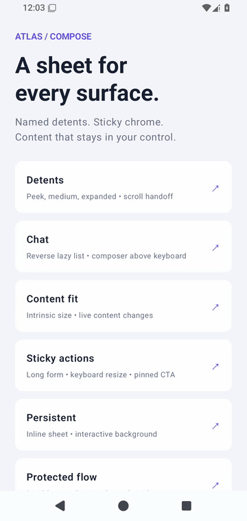
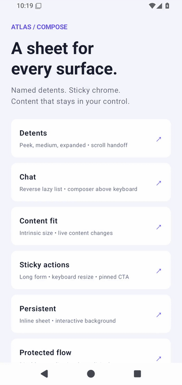
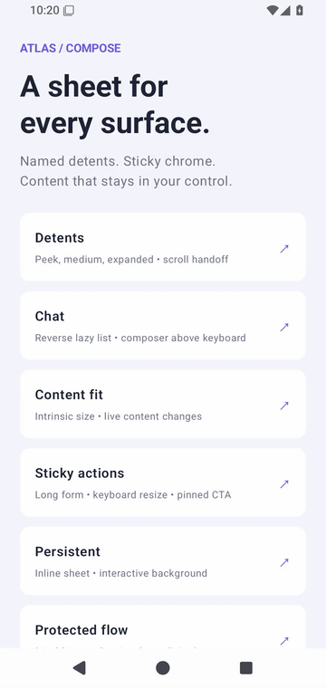
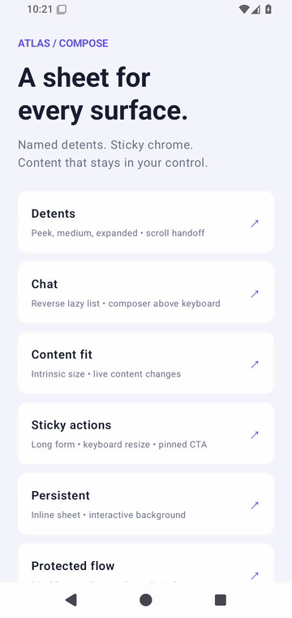
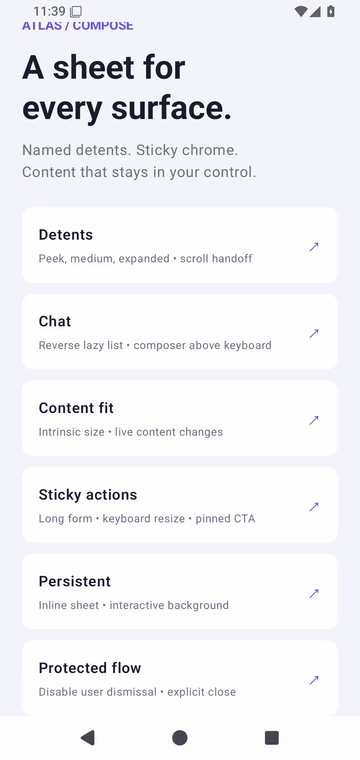

# Atlas Sheet

**Detent-driven bottom sheets for Jetpack Compose.** Named snap points, live content fit,
sticky headers and footers, lazy chat lists, a Compose-owned scrim and explicit keyboard policies.

Atlas is a Foundation-based Android library. Bring your own Material theme, design system and
content. The modal API isolates focus/input with a Dialog; the inline host supports persistent
panels over interactive content.

> **Version 0.1.0.** A working implementation with a sample and tests, not yet a production-proven
> component at millions-of-users scale. See [validation](docs/VALIDATION.md) for what was actually
> run and [architecture](docs/ARCHITECTURE.md) for boundaries and rollout work.

## Demo gallery

These are recordings of the Android sample, driven by the included instrumentation tests.
Click the video link for the full MP4; GIFs give GitHub an inline preview.
Captured on an API 35 Pixel 4 emulator (1080 × 2280) one Compose frame at a time, so sheet
motion plays at its real speed; H.264 MP4s are optimized for streaming. These are real sample
screenshots, not frame-time benchmarks.

| Scenario | Demonstrates | Recording |
| --- | --- | --- |
| Detents | Fixed, fractional and expanded heights; a lazy list; pinned actions | [MP4](docs/videos/detents.mp4) |
| Chat | Reverse lazy list, expandable composer, keyboard expansion and restoration | [MP4](docs/videos/chat.mp4) |
| Content fit | Natural sizing that updates when content is added or removed | [MP4](docs/videos/contentFit.mp4) |
| Sticky actions | A long form with a bounded scroll body and keyboard-aware footer | [MP4](docs/videos/stickyActions.mp4) |
| Persistent | An inline host without a scrim | [MP4](docs/videos/persistent.mp4) |
| Protected flow | User dismissal disabled; explicit programmatic dismissal | [MP4](docs/videos/protectedFlow.mp4) |

<details open><summary>Detents</summary>



</details>
<details><summary>Chat and keyboard</summary>



</details>
<details><summary>Live content fit</summary>



</details>
<details><summary>Sticky actions</summary>


</details>
<details><summary>Persistent panel</summary>



</details>
<details><summary>Protected flow</summary>



</details>

## Run it

Open this repository in Android Studio, select `sample`, and run on Android 24+.
Use JDK 17 and install Android SDK 35. The Gradle wrapper is included.

```bash
chmod +x gradlew # GitHub's browser uploader does not retain the executable bit.
./gradlew :sample:assembleDebug :atlas-sheet:testDebugUnitTest
./gradlew :sample:connectedDebugAndroidTest \
  -Pandroid.testInstrumentationRunnerArguments.class=dev.atlas.sheet.sample.SheetUiTest
```

The tested baseline is Compose BOM `2025.06.01` (Foundation/UI 1.8.3), Kotlin/Compose compiler
2.1.21, AGP 8.10.1 and Gradle 8.11.1. This is an explicit compatibility floor, not a claim that
these are the latest releases. Test dependency upgrades in your own app before rollout.

## Integrate

Until a public artifact is published, include the `atlas-sheet` module in your build:

```kotlin
// settings.gradle.kts
include(":atlas-sheet")
project(":atlas-sheet").projectDir = file("vendor/atlas-sheet/atlas-sheet")

// app/build.gradle.kts
implementation(project(":atlas-sheet"))
```

Or run `./gradlew :atlas-sheet:publishToMavenLocal` and use
`implementation("dev.atlas:atlas-sheet:0.1.0")` with `mavenLocal()` in a local build.
The coordinate is **not published to Maven Central**.

## Root sheet — including Fragments

Keep `AtlasSheet` mounted. It opens when mounted by default, animates its own exit,
and can reopen through state without an external visibility `if`.

```kotlin
val state = rememberSheetState(initialDetent = "medium")
val scope = rememberCoroutineScope()
AtlasSheet(
    state = state,
    detents = listOf(SheetDetent.fraction("medium", .6f), SheetDetent.expanded()),
    onDismissed = { /* navigate back after the exit completes */ },
    header = { Text("Order details", Modifier.padding(24.dp)) },
    footer = {
        Button(onClick = { scope.launch { state.hide() } }) { Text("Done") }
    },
) {
    OrderDetails()
}
```

For an initially hidden host use `rememberSheetState(initiallyVisible = false)`;
call `scope.launch { state.show() }` or `state.show("medium")` to open it. `hide()`
keeps the body mounted and clears focus/IME. `onDismissed` runs after the exit
animation finishes; it does not fire simply because the host starts hidden.
Saved state preserves the selected detent and hidden/visible state across view recreation.

A Fragment can return this ComposeView directly:

```kotlin
override fun onCreateView(
    inflater: LayoutInflater, container: ViewGroup?, savedInstanceState: Bundle?
): View = ComposeView(requireContext()).apply {
    id = R.id.order_sheet_content // stable view ID for saveable state
    setViewCompositionStrategy(ViewCompositionStrategy.DisposeOnViewTreeLifecycleDestroyed)
    setContent {
        YourTheme {
            AtlasSheet(
                detents = listOf(SheetDetent.content(), SheetDetent.expanded()),
                onDismissed = { /* pop/remove this Fragment using your navigation owner */ },
                footer = { OrderActions() },
            ) { OrderDetails() }
        }
    }
}
```

`AtlasSheet` draws inside the Fragment view rather than opening another Dialog window.
Its bounds are the parent container's bounds: use a full-window overlay Fragment container
if the sheet/scrim should cover the existing screen. Configure edge-to-edge on the Activity,
and avoid applying IME/navigation padding twice. The host owns sheet Back handling while
visible; your navigation owner handles removing the Fragment after `onDismissed`.
Activity/Fragment transitions should not also slide the same view vertically; choose one
owner for that motion. The library has no Fragment dependency.

The sample's **Fragment root example** runs a real `FragmentActivity`, overlay container,
and `RootSheetFragment` with view-lifecycle disposal. `FragmentSheetTest` verifies that exit
removes the Fragment, disposes its composition, and allows opening a fresh Fragment.

`AtlasModalSheet` remains available for callers who need Dialog-level focus/input isolation.
Its legacy lifecycle still expects removal after `onDismissRequest`; choose `AtlasSheet` for
an always-mounted in-place host. `AtlasSheetHost` remains the low-level persistent primitive.

## Motion and recordings

Entry begins from hidden after the first real chrome/body measurements, preventing a
one-frame visible flash. Detent transitions, exit and live content-fit resizing use the
state's animation spec (a damped spring by default). Dragging follows the finger directly;
IME viewport changes follow Android's insets rather than adding a second keyboard animation.
Use `animationSpec = tween(320)` or another `AnimationSpec<Float>` to customize motion.

The gallery clips are assembled from full-screen screenshots: the recording test advances the
paused Compose clock by one 32 ms output frame, waits for it to reach the display, and captures it.
Compose motion therefore keeps its real timing regardless of emulator speed, but the clips are
**not open-latency or frame-time measurements**. The keyboard animates on the device clock and can
appear abruptly in them.
The device workflow keeps system animations enabled and includes intermediate-frame tests.

## Detents

| Factory | Meaning |
| --- | --- |
| `fixed("peek", 260.dp)` | Total sheet height, including header/handle/footer |
| `fraction("medium", 0.6f)` | Fraction of the available safe viewport, excluding the IME under Resize/Expand |
| `content()` | Measured finite body height plus sticky chrome; requires Scroll mode |
| `expanded()` | All available height, respecting top margin and safe areas |
| `custom("reading") { … }` | A pure resolver with `availableHeight`, `contentHeight`, `chromeHeight` |

```kotlin
SheetDetent.custom("reading") {
    maxOf(1.dp, minOf(availableHeight * 0.8f, contentHeight + chromeHeight))
}
```

IDs must be nonblank and unique. Values must be finite and positive. Detents are clamped to the
viewport and at least the visible sticky chrome plus one pixel. If resizing makes two heights
equivalent, the first declared ID wins; the other ID remains a programmatic alias. A removed
active detent falls back to the smallest surviving one. Resolvers run during layout-related
composition: keep them inexpensive and free of side effects.
Before the first measurement, `contentHeight` and `chromeHeight` are zero; custom resolvers
must still return a positive provisional height, as the example above does.

## Chat and lazy content

Use `Fill` when the caller owns scrolling. The sheet supplies bounded constraints; the lazy
list remains lazy. A chat composer belongs in `footer`, never as the last list item.

```kotlin
AtlasModalSheet(
    state = state,
    detents = detents,
    onDismissRequest = { open = false },
    bodyMode = SheetBodyMode.Fill,
    behavior = SheetBehavior(imePolicy = SheetImePolicy.Expand),
    footer = { ChatComposer() },
) {
    LazyColumn(Modifier.fillMaxSize(), reverseLayout = true) {
        items(messages, key = { it.id }) { MessageBubble(it) }
    }
}
```

Content-fit sizing is intentionally unavailable for lazy content: uncomposed messages have no
measured natural height. Use fixed/fractional/custom detents. Keep stable list keys and hoist
your `LazyListState`; Atlas does not auto-scroll your chat when a message arrives. For reverse
lists, downward handoff occurs at that list's downward scroll boundary.

## Keyboard and scrolling

| Policy | Behavior |
| --- | --- |
| `Ignore` | Geometry ignores the keyboard; appropriate for noneditable content |
| `Resize` (default) | Keep the detent and recompute space above the keyboard |
| `Expand` | Resize, select the largest detent on keyboard open, restore the previous ID on close |

Do not add `imePadding()` or navigation-bar padding around the sheet host: Atlas already
accounts for those insets. The sample Activity is edge-to-edge. With an inline host, configure
your Activity with `enableEdgeToEdge()` and let Compose receive window insets; embedding in an
already inset/padded container would apply them twice. `Expand` restores the ID captured on
open even if you select a different detent while the keyboard is visible. Select `Resize` if
you want those user changes retained.

For regular lists, upward motion expands the sheet first; downward motion scrolls the child
first and collapses the sheet when the child cannot consume more. Set
`expandBeforeScroll = false` to let the child consume upward motion first as well.
Android's IME consumes its first Back event; subsequent Back dismisses an eligible sheet.
Predictive Back progress is not currently integrated.

## State and customization

```kotlin
val scope = rememberCoroutineScope()
scope.launch { state.animateTo("medium") }
scope.launch { state.expand() }
scope.launch { state.collapse() }
scope.launch { state.hide() }
scope.launch { state.snapTo("peek") }

val settledId = state.currentDetent  // null when hidden
val targetId = state.targetDetent
val visible = state.isVisible
val visibleFraction = state.progress
```

Suspend operations wait for the first measured host. Unknown IDs fail with an argument error;
do not call them while no host will ever be mounted. Competing animations and direct handle
drags can cancel an in-flight suspend operation; cancellation is propagated.

Configure `maxWidth`, `topMargin`, `containerColor`, `contentColor`, `scrimColor`, `shape`,
the state's `animationSpec`, and the `dragHandle`, `header`, `footer` and body slots.
`contentColor` is exposed through `LocalSheetContentColor`; your Material/other design-system
slots remain responsible for their own text/icon content colors. Set `dragHandle = null`
to omit the visual handle; the header can still be dragged. `draggable = false` disables
handle and nested-scroll sheet movement while programmatic transitions remain available.

```kotlin
SheetBehavior(
    dismissOnDrag = false,
    dismissOnScrim = false,
    dismissOnBack = false,
    draggable = true,
    imePolicy = SheetImePolicy.Resize,
)
```

Use those dismissal flags for an unsaved-data/protected flow. `hide()` always permits an
explicit exit. Atlas does not call a business-logic veto midway through a gesture.
The default motion uses a damped spring and respects Compose's animation duration scale.
Provide `snap()` as the state animation spec if your application has an explicit instant-motion
preference; system-level reduced-motion behavior still needs validation on your device matrix.

For persistent panels, place `AtlasSheetHost` last in a full-size `Box` and set
`scrimColor = Color.Unspecified`. It starts at the state's initial detent and does not own entry,
dismissal callbacks or modal focus isolation. Observe `currentDetent == null` to remove a hidden
host. The modal adds pane semantics plus expand/collapse/dismiss accessibility actions.

## Recreate the videos

Start an Android emulator/device, ensure `adb` and `ffmpeg` are on PATH, then run:

```bash
python3 scripts/record-demos.py
# Or just one:
python3 scripts/record-demos.py chat
```

The script builds and installs the sample and its test APK, enables software IME with a hardware
keyboard, runs one test per scenario, and assembles each test's per-frame screenshots into a 30 fps
MP4 and a GIF preview. Recording tests are excluded from normal CI; run the workflow manually with
`record_demos`, or push a commit whose message contains `[record-demos]`.

## Contributing and license

See [CONTRIBUTING.md](CONTRIBUTING.md), [architecture](docs/ARCHITECTURE.md) and
[validation](docs/VALIDATION.md). Apache 2.0; see [LICENSE](LICENSE).
